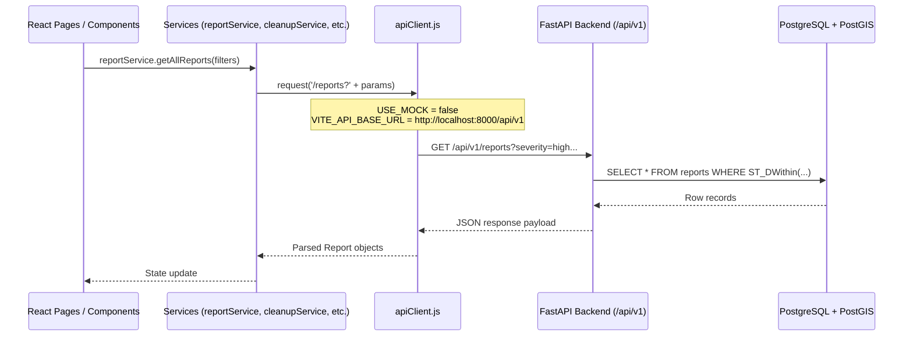
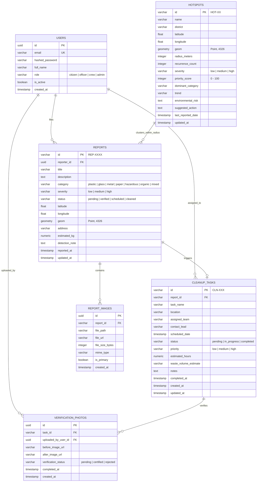

# EcoWatch AI — Phase 2A: Backend Foundation & Architecture Design

> **Document:** `PHASE2A_BACKEND_DESIGN.md`  
> **Date:** November 12, 2026  
> **Status:** Architecture Blueprint & Readiness Verification (Pre-Implementation)  
> **Target Stack:** Python FastAPI, PostgreSQL + PostGIS, SQLAlchemy, Alembic, Pydantic v2  
> **Repository Policy:** Non-destructive; strict preservation of all existing teammate frontend code and Git branch history.

---

## 1. Repository Safety Audit

A repository safety check was conducted before outlining the backend architecture:

### Git Status & Branch Inspection
- **Current Branch:** `main` (tracked to `origin/main` at commit `90860ba`).
- **Commits on Record:**
  - `90860ba`: Ignore `.vite` cache directory.
  - `7f520c9`: Merge remote repository `origin/main`.
  - `bf3e70e`: Initial commit: EcoWatch AI platform foundation (46 files).
  - `7660e3d`: Initial commit (README.md).
- **Working Tree Integrity:**
  - Modified files in working tree represent the completed Phase 1 stabilization adjustments (`ImageUploader.jsx`, `LocationPickerMap.jsx`, `reportService.js`, `cleanupService.js`, etc.).
  - Untracked audit documents: `PROJECT_READINESS_AUDIT.md`, `PHASE1_STABILITY_REPORT.md`, `src/utils/imageStorage.js`.
- **Safety Directive:** No files will be overwritten or reset. No code will be pushed to the remote repository without explicit user instructions.

---

## 2. Host Environment & Prerequisite Audit

| Component | Detection Status | Version / Path Details | Operational Notes |
| :--- | :--- | :--- | :--- |
| **Python** | **Available** | `Python 3.11.9` (`C:\Users\Varsharani\AppData\Local\Programs\Python\Python311\python.exe`) | Supported for FastAPI and Pydantic v2. |
| **pip** | **Available** | `pip 24.0` | Standard package installer ready for virtual environment creation. |
| **PostgreSQL Client** | **Available** | `psql.exe` (PostgreSQL 18.x) at `C:\Program Files\PostgreSQL\18\bin\` | CLI tools (`psql`, `pg_isready`, `pg_dump`) are installed on disk. |
| **PostgreSQL Server** | **Stopped / Not Listening** | Service check returned `no response on localhost:5432` | The Windows PostgreSQL service needs to be started or configured before running migrations. |
| **PostGIS Extension** | **Requires Initialization** | Standard contrib packages present; PostGIS binaries require verification in PostgreSQL 18 or Docker | PostGIS extension must be activated (`CREATE EXTENSION IF NOT EXISTS postgis;`) inside the target database. |
| **Docker** | **Installed (Daemon Inactive)** | `Docker version 29.7.2` | Available as an alternative to run PostgreSQL + PostGIS in an isolated container (`postgis/postgis:16-3.4`). |
| **Environment Config** | **None Existing** | No `.env` files currently exist in root | Safe template `.env.example` will be provided with no exposed secrets. |

---

## 3. Frontend Integration Analysis

### Current Communication Model (Phase 1)
The frontend currently operates entirely in the browser using the service abstraction pattern:
1. **[src/services/apiClient.js](file:///c:/Users/Varsharani/Downloads/2ND%20YEAR/evs%20final%20project/src/services/apiClient.js):**
   ```javascript
   const API_BASE_URL = import.meta.env.VITE_API_BASE_URL || '/api/v1';
   const USE_MOCK = true; // Simulates 200ms roundtrip delay
   ```
2. **Individual Services:**
   - [src/services/reportService.js](file:///c:/Users/Varsharani/Downloads/2ND%20YEAR/evs%20final%20project/src/services/reportService.js): Directly queries and writes to browser `localStorage` and `IndexedDB`.
   - [src/services/cleanupService.js](file:///c:/Users/Varsharani/Downloads/2ND%20YEAR/evs%20final%20project/src/services/cleanupService.js): Manages cleanup tasks in `localStorage`.
   - [src/services/hotspotService.js](file:///c:/Users/Varsharani/Downloads/2ND%20YEAR/evs%20final%20project/src/services/hotspotService.js): Sorts static in-memory clusters.
   - [src/services/analyticsService.js](file:///c:/Users/Varsharani/Downloads/2ND%20YEAR/evs%20final%20project/src/services/analyticsService.js): Aggregates report counts with mock KPI numbers.

### Target Communication Model with FastAPI (Phase 2)
The transition to FastAPI requires **zero changes to UI components**:


- **Step 1:** Create `.env` in the root containing `VITE_API_BASE_URL=http://localhost:8000/api/v1`.
- **Step 2:** In [src/services/apiClient.js](file:///c:/Users/Varsharani/Downloads/2ND%20YEAR/evs%20final%20project/src/services/apiClient.js), switch `const USE_MOCK = false;`.
- **Step 3:** The service wrapper methods (`reportService.getAllReports()`, `createReport()`, etc.) will delegate directly to `request()` rather than localStorage, receiving schemas matching their current format.

---

## 4. Proposed Backend Directory Architecture

The backend will live in an isolated `backend/` folder at the root of the repository, keeping frontend and backend code cleanly separated:

```
evs final project/
├── backend/
│   ├── app/
│   │   ├── __init__.py
│   │   ├── main.py                     # FastAPI app factory, CORS, global exception handlers
│   │   ├── core/
│   │   │   ├── __init__.py
│   │   │   ├── config.py               # Pydantic BaseSettings, loads .env variables
│   │   │   └── security.py             # Password hashing (bcrypt), JWT creation & verification
│   │   ├── database/
│   │   │   ├── __init__.py
│   │   │   ├── connection.py           # SQLAlchemy engine, sessionmaker, get_db dependency
│   │   │   └── base.py                 # DeclarativeBase, Common Timestamp Mixin
│   │   ├── models/
│   │   │   ├── __init__.py
│   │   │   ├── user.py                 # User ORM entity
│   │   │   ├── report.py               # PollutionReport ORM entity with PostGIS Geometry
│   │   │   ├── image.py                # ReportImage ORM entity
│   │   │   ├── cleanup.py              # CleanupTask ORM entity
│   │   │   ├── hotspot.py              # HotspotCluster ORM entity
│   │   │   └── verification.py         # CleanupVerificationPhoto ORM entity
│   │   ├── schemas/
│   │   │   ├── __init__.py
│   │   │   ├── user.py                 # UserCreate, UserLogin, UserResponse, Token
│   │   │   ├── report.py               # ReportCreate, ReportUpdate, ReportResponse
│   │   │   ├── image.py                # ImageMetadataResponse
│   │   │   ├── cleanup.py              # CleanupCreate, CleanupUpdate, CleanupResponse
│   │   │   ├── hotspot.py              # HotspotResponse, HotspotRecalculateResponse
│   │   │   └── analytics.py            # DashboardMetricsResponse, TrendItemResponse
│   │   ├── routers/
│   │   │   ├── __init__.py
│   │   │   ├── auth.py                 # /api/v1/auth
│   │   │   ├── reports.py              # /api/v1/reports
│   │   │   ├── images.py               # /api/v1/images
│   │   │   ├── cleanups.py             # /api/v1/cleanups
│   │   │   ├── hotspots.py             # /api/v1/hotspots
│   │   │   └── analytics.py            # /api/v1/analytics
│   │   ├── services/
│   │   │   ├── __init__.py
│   │   │   ├── clustering.py           # PostGIS ST_ClusterDBSCAN spatial clustering logic
│   │   │   ├── storage.py              # File upload & static directory manager
│   │   │   └── priority.py             # Environmental priority score calculator
│   │   └── utils/
│   │       ├── __init__.py
│   │       └── geo.py                  # WKT/GeoJSON coordinate parsers
│   ├── alembic/
│   │   ├── env.py                      # Alembic environment supporting GeoAlchemy2
│   │   ├── script.py.mako
│   │   └── versions/                   # Migration versions
│   ├── uploads/                        # Local image storage folder (gitignored)
│   ├── alembic.ini                     # Migration configuration
│   ├── requirements.txt                # Python backend dependencies
│   ├── .env.example                    # Template environment variables
│   ├── .gitignore                      # Python ignores (.venv, __pycache__, uploads)
│   └── README.md                       # Backend startup instructions
├── src/                                # Teammate React Frontend (Untouched)
├── package.json
└── README.md
```

---

## 5. Database Schema & Entity Design Plan



### Key Spatial Features (PostGIS)
- **Column:** `geom = Column(Geometry(geometry_type='POINT', srid=4326))` on `reports` and `hotspots`.
- **Spatial Index:** Automatically creates GIST indexes on `geom` columns for spatial queries.
- **Dynamic Cluster Query:**
  ```sql
  SELECT ST_ClusterDBSCAN(geom, eps := 0.002, minpoints := 3) OVER () AS cluster_id, id, latitude, longitude
  FROM reports;
  ```

---

## 6. API Design Plan (`/api/v1/`)

### Authentication Endpoints (`/api/v1/auth`)
- `POST /auth/register` — Register new citizen or officer.
- `POST /auth/login` — OAuth2 Password Request Form, returns JWT bearer token.
- `GET /auth/me` — Return current authenticated user profile.

### Reports Endpoints (`/api/v1/reports`)
- `GET /reports` — List reports with multi-criteria filtering:
  - Query params: `severity`, `status`, `category`, `search`, `radius_km`, `lat`, `lng`.
- `GET /reports/{id}` — Retrieve detailed report with associated images.
- `POST /reports` — Create report with JSON metadata.
- `POST /reports/upload` — Multipart form upload supporting simultaneous image file and JSON fields.
- `PATCH /reports/{id}/status` — Update report status (`verified`, `scheduled`, `cleaned`).
- `DELETE /reports/{id}` — Remove report and linked assets.

### Image Storage Endpoints (`/api/v1/images`)
- `POST /images/upload` — Upload photographic evidence; returns stored static URL `/static/uploads/{filename}`.
- `GET /images/{id}` — Retrieve image metadata.

### Cleanup Operations Endpoints (`/api/v1/cleanups`)
- `GET /cleanups` — List dispatch operations filtered by `status` (`pending`, `in_progress`, `completed`).
- `POST /cleanups` — Manually dispatch or generate cleanup task from report.
- `PATCH /cleanups/{id}/status` — Update status and trigger automatic update on linked report.
- `PATCH /cleanups/{id}/assign` — Assign cleanup squad and target execution date.
- `POST /cleanups/{id}/verify` — Upload verified "After" photo and certify task.

### Hotspot Intelligence Endpoints (`/api/v1/hotspots`)
- `GET /hotspots` — List detected hotspots sorted by `priority`, `recurrence`, or `date`.
- `GET /hotspots/{id}` — Hotspot details and linked incident history.
- `POST /hotspots/recalculate` — Trigger PostGIS DBSCAN spatial clustering and priority score recalculation.

### Analytics Endpoints (`/api/v1/analytics`)
- `GET /analytics/metrics` — City-wide operational metrics (total logged, verified, active cleanups, total kg).
- `GET /analytics/trends` — 6-month historical trajectory of logged vs. resolved reports.
- `GET /analytics/categories` — Waste material percentage breakdown.

---

## 7. Team Development & Integration Plan

To safely develop the backend in a shared repository with multiple teammates without Git merge collisions or broken frontend states:

### 1. Branching Strategy
```
main (Protected, stable production code)
  └── develop (Integration branch for frontend + backend testing)
        ├── feature/backend-foundation (Backend development)
        ├── feature/ai-yolo-pipeline (Computer vision model)
        └── feature/frontend-enhancements (Teammates' UI work)
```
- Developers working on backend work exclusively inside `backend/` on the branch `feature/backend-foundation`.
- Teammates working on UI features work on their respective frontend branches.
- Merge conflicts are eliminated because frontend and backend live in completely independent directories.

### 2. Dual-Mode Mock/Live Toggle
- The frontend will maintain its dual-mode capability via `USE_MOCK` in `apiClient.js`.
- Teammates who do not have Python or PostgreSQL installed can continue working on the UI in mock mode without needing to run the backend.
- Developers testing full-stack integration flip `USE_MOCK = false` and set `VITE_API_BASE_URL=http://localhost:8000/api/v1`.

### 3. Pre-Commit Checklist for Developers
- Ensure `.env` is never committed (enforced by `.gitignore`).
- Never run destructive Git commands (`git reset --hard`, `git push --force`).
- Run `npm run build` before merging any branch into `develop` or `main`.

---

## 8. Exact Commands to Initialize Backend Safely

When authorized to initialize the backend in Phase 2B, the exact safe commands are:

### Step 1: Create Backend Directory Structure
```powershell
New-Item -ItemType Directory -Force -Path "backend/app/core"
New-Item -ItemType Directory -Force -Path "backend/app/database"
New-Item -ItemType Directory -Force -Path "backend/app/models"
New-Item -ItemType Directory -Force -Path "backend/app/schemas"
New-Item -ItemType Directory -Force -Path "backend/app/routers"
New-Item -ItemType Directory -Force -Path "backend/app/services"
New-Item -ItemType Directory -Force -Path "backend/app/utils"
New-Item -ItemType Directory -Force -Path "backend/uploads"
```

### Step 2: Create Python Virtual Environment
```powershell
cd backend
python -m venv venv
.\venv\Scripts\Activate.ps1
```

### Step 3: Install Required Backend Dependencies
```powershell
pip install fastapi uvicorn[standard] sqlalchemy psycopg2-binary geoalchemy2 alembic pydantic pydantic-settings python-multipart python-jose[cryptography] passlib[bcrypt]
```

### Step 4: Verify PostGIS & Start PostgreSQL Service
```powershell
# Start PostgreSQL Windows Service
Start-Service -Name "postgresql-x64-18"

# Or if using Docker for PostGIS:
docker run --name ecowatch-postgis -e POSTGRES_DB=ecowatch_db -e POSTGRES_USER=postgres -e POSTGRES_PASSWORD=ecowatch_secure -p 5432:5432 -d postgis/postgis:16-3.4
```

### Step 5: Run Alembic Database Migrations
```powershell
alembic init alembic
alembic revision --autogenerate -m "Initial EcoWatch schema with PostGIS"
alembic upgrade head
```

### Step 6: Launch FastAPI Development Server
```powershell
uvicorn app.main:app --reload --port 8000
```

---
*Blueprint complete. No code modified, no packages installed, and no Git resets performed. Ready for Phase 2B upon user approval.*

