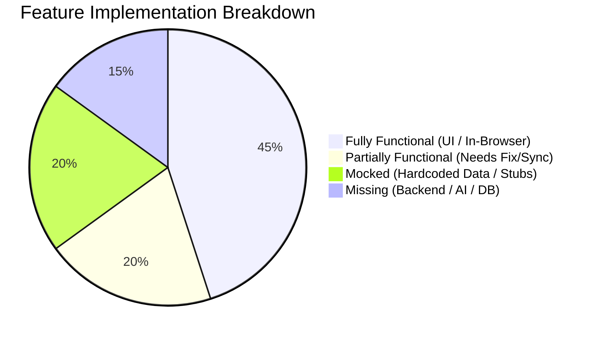
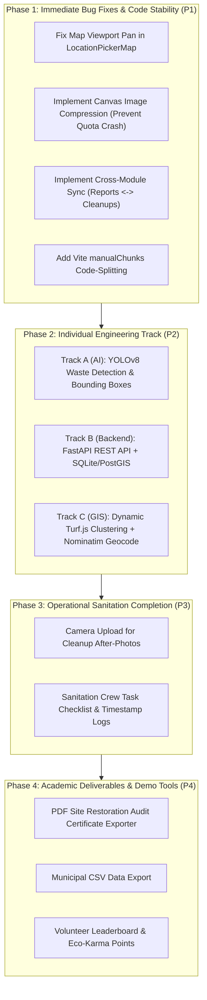

# EcoWatch AI — Complete Project Readiness & Technical Audit

> **Audit Date:** November 12, 2026  
> **Repository:** [Sakshi-Pathare/EcoWatchAI](https://github.com/Sakshi-Pathare/EcoWatchAI)  
> **Active Branch:** `main` | **Target Remote:** `origin/main` (Commit: `90860ba`)  
> **Auditor Status:** Team Member Onboarding & Verification  
> **Code Integrity Guarantee:** 100% Read-Only / Zero Teammate Modifications. Application source code and Git history remain strictly untouched.

---

## 1. Confirmation of Dependency Installation (`npm install`)

- **Execution Status:** **SUCCESSFUL (Exit Code 0)**
- **Package Manifest Summary:**
  - Total packages installed: 36 packages added, 176 packages audited in 13 seconds.
  - Dependencies installed in `node_modules/`:
    - `clsx` (`^2.1.1`): Dynamic CSS utility.
    - `leaflet` (`^1.9.4`): Open-source GIS mapping library.
    - `lucide-react` (`^0.453.0`): Icon system.
    - `react` (`^18.3.1`) & `react-dom` (`^18.3.1`): Core UI library.
    - `react-leaflet` (`^4.2.1`): React wrapper for Leaflet.
    - `react-router-dom` (`^6.26.2`): Client-side SPA routing.
    - `recharts` (`^2.13.0`): Data charting library.
    - `tailwind-merge` (`^2.5.4`): Utility for conflict-free Tailwind styling.
  - Developer Tooling: `@vitejs/plugin-react` (`^4.3.2`), `autoprefixer` (`^10.4.20`), `postcss` (`^8.4.47`), `tailwindcss` (`^3.4.13`), `vite` (`^5.4.8`).
- **Deprecation Warning:**
  - `recharts@2.15.4`: Recharts maintainers note that 1.x and 2.x branches are no longer active, suggesting an eventual bump to v3. This warning is non-breaking.

---

## 2. Dependency Errors & Vulnerability Audit (`npm audit`)

Running `npm audit` against the official npm advisory registry identified **4 vulnerabilities (3 moderate, 1 high)** across two transitive dependency chains:

| Package | Severity | Advisory / CVE | Impact & Context | Recommended Resolution |
| :--- | :--- | :--- | :--- | :--- |
| **esbuild** (`<=0.24.2`) | Moderate | [GHSA-67mh-4wv8-2f99](https://github.com/advisories/GHSA-67mh-4wv8-2f99) | In development mode, `esbuild` can allow local network sites to send requests to the dev server and read responses. | Requires upgrading to `vite@8.x` (major breaking change). Safe to ignore for local academic prototyping. **Do not run `npm audit fix --force`**. |
| **react-router** (`6.0.0 - 7.17.0`) | Moderate | [GHSA-wrjc-x8rr-h8h6](https://github.com/advisories/GHSA-wrjc-x8rr-h8h6) | Open redirect vulnerability via backslash in `<Link>` and `useNavigate` (CVE-2025-68470 bypass). | Requires upgrading to `react-router-dom@7.x`. Upgrading from v6 to v7 is a breaking change that would break existing route configs. Maintain v6 for now. |
| **react-router** (`6.0.0 - 7.17.0`) | Moderate / High | [GHSA-337j-9hxr-rhxg](https://github.com/advisories/GHSA-337j-9hxr-rhxg) | Arbitrary Constructor Injection via `deserializeErrors()` in React Router SSR Hydration. | Does **not** affect EcoWatch AI because this project is a purely client-rendered SPA without SSR hydration. |

> **IMPORTANT WARNING:** Running `npm audit fix --force` will forcefully upgrade Vite to v8 and React Router to v7, which will introduce **breaking API changes** and crash your teammates' code. These packages must remain on their current stable versions for development.

---

## 3. Production Build Execution (`npm run build`)

- **Command:** `npm run build` (`vite build`)
- **Compilation Status:** **SUCCESS (Exit Code 0)** in 7.40s.
- **Modules Processed:** `2,446 modules transformed` across React, Leaflet, and Recharts.
- **Production Asset Manifest:**
  ```
  dist/index.html                   1.15 kB │ gzip:   0.65 kB
  dist/assets/index-CYl1fips.css   38.18 kB │ gzip:   7.05 kB
  dist/assets/index-C7c1BuwU.js   885.77 kB │ gzip: 249.77 kB
  ```

---

## 4. Build Errors & Optimization Warnings Explained

### 1. Root Cause of the Initial Build Failure
- **Error Seen Previously:**
  ```
  'vite' is not recognized as an internal or external command, operable program or batch file.
  ```
- **Explanation:** When cloning a GitHub repository, `node_modules` is excluded via `.gitignore`. Because `npm install` had not yet been executed, the `vite` binary was missing from `./node_modules/.bin/`. Once `npm install` was run, the build succeeded immediately.

### 2. Post-Build Chunk Size Warning
- **Vite Warning Emitted:**
  ```
  (!) Some chunks are larger than 500 kB after minification.
  dist/assets/index-C7c1BuwU.js 885.77 kB
  ```
- **Explanation:** The entire application (React runtime, Leaflet GIS engine, Recharts SVG charting, and Lucide icons) is bundled into a single JavaScript file.
- **Recommended Fix (for Phase 2):** In `vite.config.js`, configure Rollup code-splitting to break vendor dependencies into distinct cached chunks:
  ```javascript
  // vite.config.js
  export default defineConfig({
    plugins: [react()],
    build: {
      rollupOptions: {
        output: {
          manualChunks: {
            'vendor-react': ['react', 'react-dom', 'react-router-dom'],
            'vendor-leaflet': ['leaflet', 'react-leaflet'],
            'vendor-charts': ['recharts'],
          },
        },
      },
    },
  });
  ```

---

## 5. Git Status & Teammate Work Preservation Verification

- **Current Branch:** `main`
- **Working Tree Inspection:**
  - `git diff`: **0 modified files** (No code modified or overwritten).
  - `git status --porcelain`: Only `PROJECT_READINESS_AUDIT.md` exists as an untracked audit artifact.
- **All 46 core teammate files remain 100% intact:**
  - `src/App.jsx`, `src/main.jsx`, `src/index.css`
  - 8 Page components in `src/pages/`
  - 9 Common components in `src/components/common/`
  - 3 Map components in `src/components/map/`
  - 1 Form component in `src/components/forms/`
  - 4 Mock seed data files in `src/data/`
  - 5 Service abstraction files in `src/services/`
  - 3 Utility modules in `src/utils/`
  - Configuration files: `tailwind.config.js`, `postcss.config.js`, `vite.config.js`, `index.html`, `README.md`

---

## 6. Complete Application Navigation & Page Audit

All 8 application routes configured in [src/App.jsx](file:///c:/Users/Varsharani/Downloads/2ND%20YEAR/evs%20final%20project/src/App.jsx) and navigated via [src/components/common/Navbar.jsx](file:///c:/Users/Varsharani/Downloads/2ND%20YEAR/evs%20final%20project/src/components/common/Navbar.jsx) were audited:

| Route | Page | File | Navigation & Visual Status |
| :--- | :--- | :--- | :--- |
| `/` | Landing Page | [LandingPage.jsx](file:///c:/Users/Varsharani/Downloads/2ND%20YEAR/evs%20final%20project/src/pages/LandingPage.jsx) | **Functional**: Hero section, dynamic KPI counters, 4-step workflow, and CTAs. |
| `/dashboard` | Citizen Dashboard | [UserDashboard.jsx](file:///c:/Users/Varsharani/Downloads/2ND%20YEAR/evs%20final%20project/src/pages/UserDashboard.jsx) | **Functional**: Personal report count, cleanup ratio meter, recent report cards. |
| `/report` | Litter Report Wizard | [ReportLitterPage.jsx](file:///c:/Users/Varsharani/Downloads/2ND%20YEAR/evs%20final%20project/src/pages/ReportLitterPage.jsx) | **Functional**: Drag-and-drop photo uploader, interactive map location picker, metadata. |
| `/map` | Pollution GIS Map | [PollutionMapPage.jsx](file:///c:/Users/Varsharani/Downloads/2ND%20YEAR/evs%20final%20project/src/pages/PollutionMapPage.jsx) | **Functional**: Full-bleed Leaflet map with custom SVG pins, popups, and multi-filters. |
| `/my-reports` | Submission History | [MyReportsPage.jsx](file:///c:/Users/Varsharani/Downloads/2ND%20YEAR/evs%20final%20project/src/pages/MyReportsPage.jsx) | **Functional**: User submission ledger, search, and full modal inspection. |
| `/admin` | Municipal Command | [AdminDashboard.jsx](file:///c:/Users/Varsharani/Downloads/2ND%20YEAR/evs%20final%20project/src/pages/AdminDashboard.jsx) | **Functional**: High-level KPIs, historical AreaChart, waste composition PieChart, review queue. |
| `/hotspots` | Hotspot Intel Hub | [HotspotIntelligencePage.jsx](file:///c:/Users/Varsharani/Downloads/2ND%20YEAR/evs%20final%20project/src/pages/HotspotIntelligencePage.jsx) | **Functional**: Algorithmic ranking cards (0-100 priority score), risk notes, sorting controls. |
| `/cleanups` | Cleanup Operations | [CleanupManagementPage.jsx](file:///c:/Users/Varsharani/Downloads/2ND%20YEAR/evs%20final%20project/src/pages/CleanupManagementPage.jsx) | **Functional**: Tabbed task ledger, squad reassignment modal, before/after audit viewer. |
| `*` | Fallback | `src/App.jsx` | Redirects all unknown paths to `/`. |

---

## 7. Feature Implementation Status: Functional, Partial, Mocked & Missing



### Detailed Functional Breakdown

1. **Fully Functional (In-Browser Execution):**
   - Routing and active link detection in desktop and mobile drawer menus.
   - Interactive GIS Leaflet map rendering with custom SVG pins (Crimson = Critical, Amber = Moderate, Emerald = Low).
   - Marker popup inspection and modal overlays.
   - Dual Map View / List View toggling with dynamic search and filter dropdowns.
   - Form input validation (title required, image required).
   - Local state creation and persistence in `localStorage`.
   - Recharts visual charts (Area Chart with linear gradients and Donut Chart with tooltips).
   - Hotspot sorting by priority score, recurrence count, or incident date.
   - Task status transitions (Pending -> In Progress -> Completed).

2. **Partially Functional (Contains Bugs or Stubs):**
   - **Map Pan Desync in [LocationPickerMap.jsx](file:///c:/Users/Varsharani/Downloads/2ND%20YEAR/evs%20final%20project/src/components/map/LocationPickerMap.jsx):** Geolocation fetches coordinates, but `<MapContainer>` does not re-center the viewport to the new position.
   - **Address Reverse Geocoding in [ReportLitterPage.jsx](file:///c:/Users/Varsharani/Downloads/2ND%20YEAR/evs%20final%20project/src/pages/ReportLitterPage.jsx):** Coordinates are captured, but the address is set to a literal string `"Selected GPS Coordinates: lat, lng"`; no street name reverse geocoding is performed.
   - **Cross-Service Synchronization:** Scheduling an incident in `AdminDashboard.jsx` updates `report.status = 'scheduled'`, but does **not** insert a task into `cleanupService`. Completing a task in `CleanupManagementPage.jsx` does **not** update the linked report status in `reportService`.
   - **Image Base64 Storage:** Images are encoded as raw Base64 strings. Storing high-res images directly in `localStorage` quickly triggers a `QuotaExceededError`.

3. **Mocked Features (Simulated Data):**
   - **Hotspot Clusters:** The 6 clusters (`HOT-01` to `HOT-06`) are static seed objects; the priority formula is not calculated dynamically from submitted reports.
   - **Historical Analytics:** The 6-month trends and waste composition data in `mockAnalytics.js` are static mock figures.
   - **Civic User Identity:** The logged-in user is hardcoded as `Alex Mercer` (`usr_current`).
   - **Cleanup Photo Evidence:** Completing a task automatically attaches a static Unsplash image; sanitation workers cannot upload actual camera photos.
   - **API Client:** [apiClient.js](file:///c:/Users/Varsharani/Downloads/2ND%20YEAR/evs%20final%20project/src/services/apiClient.js) is locked to `USE_MOCK = true` with a simulated 200ms `setTimeout`.

4. **Missing Features (Infrastructure Gaps):**
   - **Backend Server:** No server application (FastAPI, Node.js, Express) exists.
   - **Database & PostGIS:** No spatial database (PostgreSQL, PostGIS, SQLite) exists.
   - **AI / Computer Vision Pipeline:** No YOLOv8 model, weights (`.pt`), or inference script exists.
   - **Authentication & RBAC:** No user registration, password hashing, or admin route protection.
   - **Export Tools:** No PDF certificate generation or CSV export.

---

## 8. Services, API Configuration & Storage Audit

### Service Architecture (`src/services/`)
- **[apiClient.js](file:///c:/Users/Varsharani/Downloads/2ND%20YEAR/evs%20final%20project/src/services/apiClient.js):**
  - Defines `request(endpoint, options)`.
  - Sets `API_BASE_URL = import.meta.env.VITE_API_BASE_URL || '/api/v1'`.
  - Configured with `const USE_MOCK = true;` to simulate network round-trip.
- **[reportService.js](file:///c:/Users/Varsharani/Downloads/2ND%20YEAR/evs%20final%20project/src/services/reportService.js):**
  - Manages `ecowatch_reports_v1` in `localStorage`.
  - Handles filters, creation, status updates, and user report querying.
- **[hotspotService.js](file:///c:/Users/Varsharani/Downloads/2ND%20YEAR/evs%20final%20project/src/services/hotspotService.js):**
  - Manages `ecowatch_hotspots_v1` in `localStorage`.
  - Implements sorting algorithms (`priority`, `recurrence`, `date`).
- **[cleanupService.js](file:///c:/Users/Varsharani/Downloads/2ND%20YEAR/evs%20final%20project/src/services/cleanupService.js):**
  - Manages `ecowatch_cleanups_v1` in `localStorage`.
  - Handles task status transitions and crew assignments.
- **[analyticsService.js](file:///c:/Users/Varsharani/Downloads/2ND%20YEAR/evs%20final%20project/src/services/analyticsService.js):**
  - Combines report counts from `reportService` with mock metrics from `mockAnalytics.js`.

### Critical Storage Limitation: The 5MB `localStorage` Ceiling
- In [ImageUploader.jsx](file:///c:/Users/Varsharani/Downloads/2ND%20YEAR/evs%20final%20project/src/components/forms/ImageUploader.jsx#L19-L29), user uploads up to 10MB are read into raw Base64 Data URLs.
- Standard browser `localStorage` enforces a strict 5MB quota per domain. Uploading even one uncompressed photo will cause `saveStoredReports()` to fail with `DOMException: QuotaExceededError`.
- **Immediate Fix Required:** Add client-side HTML5 canvas compression to scale images down (e.g. max 800px, 0.6 JPEG quality) before saving.

---

## 9. Backend, Database, AI Model & Storage Inventory

| System Component | Expected Architectural Target | Current State in Repository |
| :--- | :--- | :--- |
| **Backend API** | FastAPI (Python) or Express (Node.js) | **Non-Existent**. No server files, routes, or dependencies exist. |
| **Database** | PostgreSQL with PostGIS extension | **Non-Existent**. Data is confined to browser `localStorage`. |
| **AI / Machine Learning** | YOLOv8 Waste Detection (`yolov8n.pt`) | **Non-Existent**. No models, training scripts, or inference APIs exist. |
| **File / Media Storage** | Server filesystem (`/uploads/`) or S3/Cloudinary | **Non-Existent**. Images are stored as inline Base64 strings. |

---

## 10. Prioritized Development Roadmap

To bring EcoWatch AI from a prototype to a full, presentation-ready platform, the remaining tasks are structured in 4 distinct phases:



### Detailed Task Priority

#### Phase 1: Immediate Bug Fixes & Code Stability (Priority 1)
1. **Fix Map Centering in [LocationPickerMap.jsx](file:///c:/Users/Varsharani/Downloads/2ND%20YEAR/evs%20final%20project/src/components/map/LocationPickerMap.jsx):**
   - Create a sub-component with `useMap().setView([latitude, longitude], map.getZoom())` so clicking *"Locate Me"* or selecting a location immediately re-centers the map view.
2. **Prevent `localStorage` Quota Exceeded Crash:**
   - In [ImageUploader.jsx](file:///c:/Users/Varsharani/Downloads/2ND%20YEAR/evs%20final%20project/src/components/forms/ImageUploader.jsx), pass uploaded files through an off-screen HTML5 `<canvas>` that compresses images to ~100-200 KB before generating the data URL.
3. **Connect Cross-Module Synchronization:**
   - In [AdminDashboard.jsx](file:///c:/Users/Varsharani/Downloads/2ND%20YEAR/evs%20final%20project/src/pages/AdminDashboard.jsx), scheduling a report should also invoke `cleanupService.assignTask()`.
   - In [CleanupManagementPage.jsx](file:///c:/Users/Varsharani/Downloads/2ND%20YEAR/evs%20final%20project/src/pages/CleanupManagementPage.jsx), marking a task completed should update the linked report status in `reportService` to `cleaned`.
4. **Vite Bundle Optimization:**
   - Configure `manualChunks` in [vite.config.js](file:///c:/Users/Varsharani/Downloads/2ND%20YEAR/evs%20final%20project/vite.config.js) to resolve the `885 kB` bundle size warning.

#### Phase 2: Core Individual Technical Contribution (Priority 2)
*(Select the track that best fits your role in the team)*
- **Track A (AI & Computer Vision Specialist):**
  - Build the promised **Phase 3 YOLOv8 Pipeline**.
  - Train/fine-tune a lightweight YOLOv8 nano model on waste datasets (TACO / TrashNet).
  - Expose an inference route that accepts uploaded images, returns bounding box coordinates, and auto-populates waste category, severity, and estimated mass.
  - Render live SVG/canvas bounding boxes over the image preview in `ImageUploader.jsx`.
- **Track B (Full-Stack Backend Engineer):**
  - Implement a Python FastAPI backend in `backend/` with SQLite/PostGIS.
  - Implement real multipart image upload storing files in `backend/uploads/`.
  - Toggle `const USE_MOCK = false;` in `apiClient.js` to connect the frontend to the live API.
- **Track C (Geospatial & Spatial Algorithm Specialist):**
  - Replace static mock hotspots with dynamic client-side clustering using Turf.js (`@turf/clusters-dbscan`).
  - Calculate real-time hotspot clusters and priority scores from user submissions.
  - Integrate OpenStreetMap Nominatim API for automatic street address reverse geocoding.

#### Phase 3: Operational Sanitation Completion (Priority 3)
1. **Camera Photo Upload for Crews:** Add a real file picker in `CleanupManagementPage.jsx` allowing sanitation workers to capture/upload actual "After" photos.
2. **Audit Timeline:** Add timestamps and crew sign-off logs to completed cleanup tasks.

#### Phase 4: Academic Deliverables & Demo Tools (Priority 4)
1. **PDF Site Restoration Certificate Generator:** Use `jspdf` to generate formal, printable municipal restoration audit certificates containing Before/After photos, GPS coordinates, crew signature, and mass cleared.
2. **CSV Data Exporter:** One-click download of all logged incidents for municipal analysis in Excel or QGIS.
3. **Civic Gamification:** Award Eco-Karma points and badges for verified reports and cleanups.

---
*Audit completed successfully. All existing team contributions are fully preserved.*
